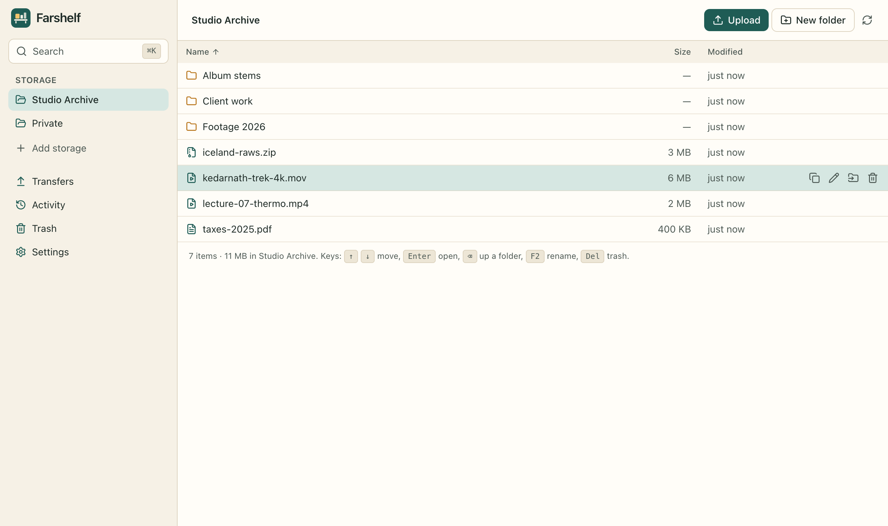
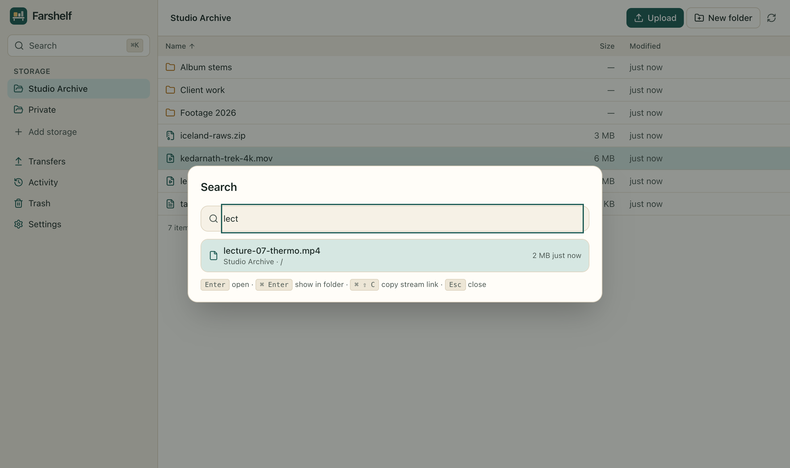

# Farshelf

**Keep big files on storage you control, and open them as if they were on your computer.**

Farshelf is a free, open-source, local-first daemon with a web UI. It connects to a
folder, a NAS, a WebDAV/Nextcloud server or your Google Drive, and gives you:

- **Streaming opens.** Every read is a byte-range read, so a player starts a 50 GB
  video without downloading the whole file first. Streamed pieces stay in a capped
  in-memory cache and are never written to your disk.
- **A drive for your file manager.** A built-in WebDAV server mounts in Finder,
  Windows Explorer, GNOME Files or Dolphin.
- **Uploads that survive restarts.** Drop files or whole folders in. A persistent
  queue uploads them in the background, resumes after sleep, network loss or a
  restart, and shows progress, speed and time remaining.
- **Optional end-to-end encryption.** File contents and names are encrypted on your
  computer with AES-256-GCM in 1 MiB segments, so encrypted files still stream. The
  format is [documented](docs/FORMAT.md), and `farshelf decrypt` works offline.
- **Search, trash and history.** ⌘K / Ctrl+K searches every indexed name. Deleted items
  go to a 30-day trash. A searchable activity log records what happened.
- **Optional AI that only proposes.** Ask in plain words (“videos over 10 GB from this
  year”, “put the wav files here into a folder called stems”). The model returns a
  filter or a plan, which Farshelf validates and shows you. **Nothing runs until you
  approve each step.** Works with local models through [Ollama](https://ollama.com) or
  any OpenAI-compatible endpoint. Off by default.

There is no account, no subscription, no telemetry and no Farshelf server. Your files
only ever move between your computer and the storage you choose.





> **Status: 0.1, early.** The core workflow is implemented and covered by automated
> tests (see [Testing](#testing)). Read [Known limitations](#known-limitations) before
> trusting it with data you have no other copy of.

## Why Farshelf exists

Laptops ship with small SSDs, while cloud storage people already pay for sits mostly
unused. Commercial tools that mount cloud storage as an on-demand disk exist, but they
are typically closed source, paid, tied to one OS, and may send usage analytics.
Farshelf takes the same idea and makes it:

|           | Farshelf                                                            |
| --------- | ------------------------------------------------------------------- |
| Price     | Free, Apache-2.0, no paid tiers or quotas                           |
| Platforms | macOS, Linux, Windows (Node.js), and headless on a home server      |
| Storage   | Local folder / NAS, WebDAV / Nextcloud, Google Drive (more welcome) |
| Privacy   | No telemetry; secrets in the OS keychain; open encryption format    |
| AI        | Optional, local-first, approval-gated, never sees file contents     |

The reference analysis that shaped the design is in [`docs/research/`](docs/research/).

## Quick start

Requirements: **Node.js 22.18 or newer** (it uses the built-in `node:sqlite`). No
compiler or native modules are needed.

```bash
git clone https://github.com/20parth/farshelf.git
cd farshelf
npm ci
npm run build
npm start
```

Farshelf prints a private login link and opens it in your browser:

```
Farshelf 0.1.0 running at http://127.0.0.1:7420
Open this link to sign in to the UI (keep it private):
  http://127.0.0.1:7420/login#t=…
```

Lost the tab? Run `node dist/server/server/cli.js url` (or `farshelf url` if installed
globally with `npm install -g .`).

Onboarding asks where your files should live. The default, a folder on this computer,
works immediately. Add a passphrase if you want encryption, and save the recovery key
it shows you.

### Mount it in your file manager

Settings › _Use it in your file manager_ shows the WebDAV address
(`http://127.0.0.1:7420/dav/`), the user `farshelf` and a generated password.

- **macOS:** click **Mount in Finder**, or Finder › Go › Connect to Server (⌘K).
- **Windows:** File Explorer › This PC › Map network drive › “Connect to a Web site…”.
- **Linux:** Files/Dolphin › Other Locations › `dav://127.0.0.1:7420/dav/`.

Each storage location appears as a top-level folder.

### Stream into a player

Click a file to open it in the browser, or use **Copy stream link** (the copy icon, or
⌘⇧C in search) and paste the link into VLC, IINA or mpv. Links are signed per file and
work only for that one file.

## CLI

```
farshelf start [--port 7420] [--host 127.0.0.1] [--no-open] [--secrets auto|database|memory] [--home DIR]
farshelf url                                    print the login link
farshelf decrypt <encrypted-folder> <output>    decrypt a local copy of an encrypted remote
farshelf reset --yes                            delete Farshelf's data on this machine (not your files)
```

See [docs/CONFIGURATION.md](docs/CONFIGURATION.md) for environment variables and
every setting.

## Storage backends

| Backend            | Streaming  | Resumable uploads  | Notes                                                                                                                                 |
| ------------------ | ---------- | ------------------ | ------------------------------------------------------------------------------------------------------------------------------------- |
| Local folder       | ✅         | ✅                 | External disks, NAS mounts, a folder another sync client manages                                                                      |
| WebDAV / Nextcloud | ✅ (Range) | ❌ restarts from 0 | Any RFC 4918 server                                                                                                                   |
| Google Drive       | ✅ (Range) | ✅ native sessions | `drive.file` scope: sees only files Farshelf created. **Bring your own OAuth client**: [setup](docs/AI_AND_PROVIDERS.md#google-drive) |
| Dropbox            | —          | —                  | Not implemented yet ([roadmap](docs/ROADMAP.md))                                                                                      |

Google Drive and Nextcloud storage is billed by those providers under their own plans.
Farshelf never charges anything.

## AI (optional)

AI is off until you enable it in Settings › AI.

- **Local:** install [Ollama](https://ollama.com), run `ollama pull llama3.2`, then
  enable AI. Requests never leave your computer. Small models need roughly 4–8 GB of
  RAM. Quality varies by model, and invalid answers are rejected rather than run.
- **OpenAI-compatible:** LM Studio, llama.cpp server, vLLM, or a hosted API. Hosted
  providers charge for their own usage. API keys are stored in your OS keychain when
  one is available.

What is sent: your question and, only if you tick _share names_ for that request, the
names, sizes and dates of items in the current folder. Contents are never sent, and
names from encrypted storage are never sent. Details:
[docs/AI_AND_PROVIDERS.md](docs/AI_AND_PROVIDERS.md).

## Security and privacy

- Listens on `127.0.0.1` only by default. Access needs the private login link
  (session cookie), WebDAV credentials, or a per-file signed stream link.
- Rejects unexpected `Host` headers (DNS rebinding) and cross-origin writes.
- Sign-in tokens, WebDAV passwords and unlocked keys go in the macOS Keychain or the
  Linux Secret Service. Without one, they are kept in the local database, and
  encrypted remotes must be unlocked after every restart.
- No telemetry, no analytics, no update checks.

Read the full model, including what it does **not** protect against, in
[docs/SECURITY_MODEL.md](docs/SECURITY_MODEL.md). Report vulnerabilities privately:
see [SECURITY.md](SECURITY.md).

## Known limitations

- **Finder and some other WebDAV clients copy a whole file locally when it is
  opened.** For true streaming of big media, open files from the Farshelf UI or use a
  stream link. A native FSKit/FUSE front end is on the roadmap.
- No tray icon, global hotkey or autostart yet. These need the planned desktop shell.
- No public share links yet. Dropbox is not supported.
- Google Drive support is tested against a mock of the API, not against live Google
  servers.
- Tested on macOS (Apple silicon) and in CI on Ubuntu and macOS. Windows is untested.

The complete list is in
[docs/research/KNOWN_LIMITATIONS.md](docs/research/KNOWN_LIMITATIONS.md).

## Testing

```bash
npm test             # unit, integration and component tests (Vitest)
npm run test:e2e     # end-to-end journey in a real browser (Playwright + axe)
npm run check        # typecheck + lint + tests + production build
```

The end-to-end test starts the real daemon. It onboards with encryption, uploads,
checks that only ciphertext is on disk, creates, moves, renames, trashes and restores
files, searches, streams a byte range, restarts the daemon, and unlocks with the
recovery key. It runs accessibility scans along the way. It uses your installed Google
Chrome by default. Set `PLAYWRIGHT_CHANNEL=chromium` after
`npx playwright install chromium` otherwise.

## Documentation

- [Architecture](docs/ARCHITECTURE.md) · [Encryption format](docs/FORMAT.md) · [Security model](docs/SECURITY_MODEL.md)
- [Configuration](docs/CONFIGURATION.md) · [AI and storage providers](docs/AI_AND_PROVIDERS.md) · [Troubleshooting](docs/TROUBLESHOOTING.md)
- [Roadmap](docs/ROADMAP.md) · [Releasing](docs/RELEASING.md) · [Contributing](CONTRIBUTING.md)

## License

[Apache-2.0](LICENSE). Farshelf is an independent project. It is not affiliated with or
endorsed by any commercial product or storage provider mentioned in this repository.
